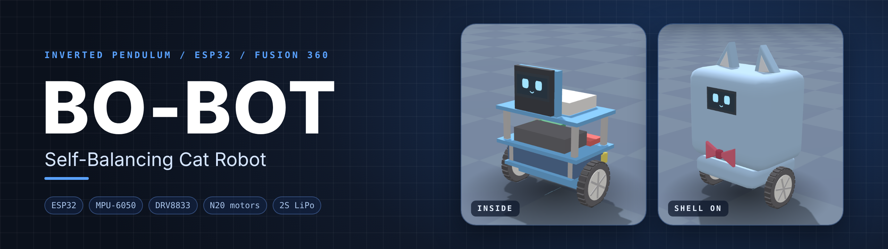
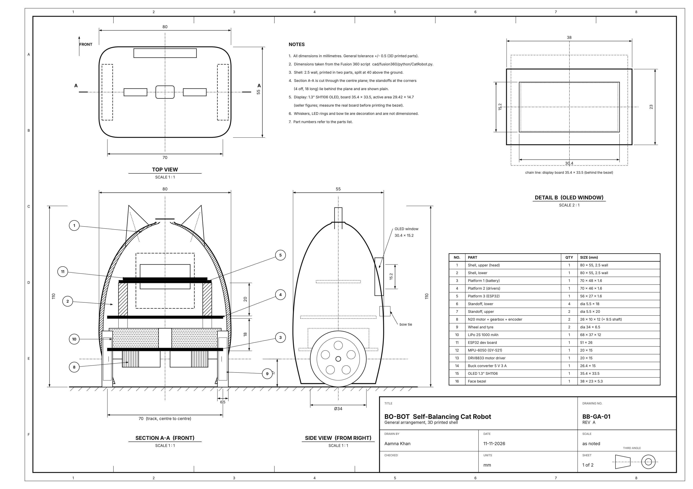
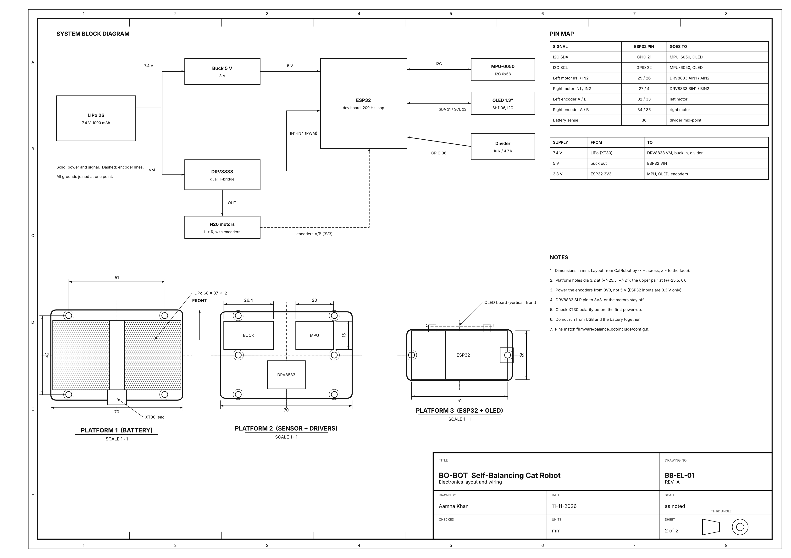
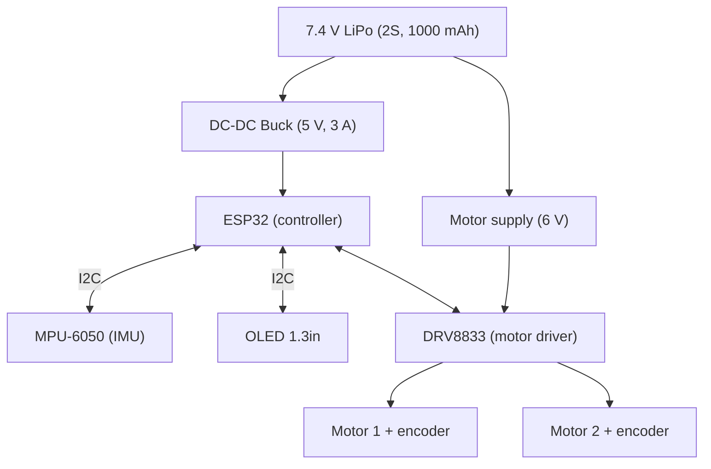

<div align="center">



<br>

**A two-wheeled, self-balancing robot with a cat-shaped casing and an animated OLED face.**<br>
Mechanical design, electronics, firmware, simulation and documentation, all in one place.

<br>

**[▶ Try the live simulator](https://aamna-builds.github.io/Bo-Bot/)**

[](https://github.com/aamna-builds/Bo-Bot/actions/workflows/ci.yml)


[About](#about) ·
[Design](#design) ·
[Specifications](#specifications) ·
[Simulation](#simulation) ·
[Architecture](#system-architecture) ·
[Repository](#repository-structure) ·
[Roadmap](#roadmap)

</div>

---

## About

BO-BOT is an **inverted-pendulum robot**: it stands upright on two wheels and keeps its balance by continuously
measuring its tilt and driving the wheels to correct it. The body is a compact cat-shaped casing, first built as a
low-cost **thermocol prototype**, with a small OLED screen that shows a fixed pair of eyes and an animated mouth
(happy, talking, surprised, sad).

The project covers the full engineering workflow:

- **Mechanical:** parametric CAD, layered chassis, casing design and build
- **Electronics:** power distribution, motor driving, sensing and wiring
- **Control:** balance controller, tuned with simulation before running on hardware
- **Software:** ESP32 firmware, OLED face animation
- **Documentation:** bill of materials, wiring, build photos and videos

## Design

The design is a three-platform chassis inside an egg-shaped cat shell. The battery sits low to keep the centre of mass
close to the axle, drivers and sensors sit on the middle platform, and the ESP32 and OLED face sit at the top.

**Concept sketches:** early ideas for the outer layer, internal structure, LED face expressions and alternative looks.

<p align="center">
  
</p>

**Engineering drawings (A3, third angle):** the sizes come straight from the Fusion 360 script in [`cad/`](cad/), so the drawings
and the CAD model agree. The picture is the first sheet; click it for full size.

<p align="center">
  <a href="docs/drawings/sheet1-general-arrangement.png"></a><br>
  <sub>Sheet 1: general arrangement (section A-A, side view, top view, OLED window detail, parts list).</sub>
</p>

<p align="center">
  <a href="docs/drawings/sheet2-electronics.png"></a><br>
  <sub>Sheet 2: electronics layout on the three platforms, system block diagram and pin map.</sub>
</p>

The sheets are drawn by [`docs/drawings/draw_sheets.py`](docs/drawings/draw_sheets.py); change a number there and run it to redraw them.
The first picture-style design sheets (drawn for a 0.96" display, with the thermocol casing) are kept in
[`docs/images/archive/`](docs/images/archive/). The build uses a **1.3" SH1106 OLED**, and the CAD model and these drawings are
for that display.

## Simulation

**[▶ Open the live simulator](https://aamna-builds.github.io/Bo-Bot/)** (any modern browser, nothing to install; it also works offline by
opening [`simulation/web/index.html`](simulation/web/index.html)).

A 3D bench model of the robot running the **same control law as the ESP32 firmware** (cascaded speed and angle loops at 200 Hz), with the
motors, gearbox backlash, battery, MPU-6050 and encoders modelled from datasheet values.

- **Drive and push it:** arrow keys or the on-screen pad to drive and turn, `X` / `Z` to shove it, `R` to pick it up and set it back down.
- **Tune it live:** sliders for every firmware gain (kp, kd, ki, kp_v, ki_v, trim, ...) in the firmware's own units, plus a "tuned defaults" reset.
- **Break it on purpose:** change backlash, move the MPU to another deck, add tilt error or extra weight, or run the battery down to 15 %.
- **Look inside:** toggle the cat shell and an X-ray view; the OLED face reacts to what the robot is doing.
- **Read the traces:** live pitch, motor PWM and speed plots, three camera modes, and a record button that saves a video.
- **Light or dark mode:** the toggle is in the top corner.

Details and the offline video recorder are in [`simulation/README.md`](simulation/README.md). The maths behind it is in
[`docs/equations.md`](docs/equations.md) and [`simulink/`](simulink/).

<p align="center">
  <br>
  <sub>Scripted demo: balancing, driving, turning and recovering from pushes.
  <a href="media/videos/simulation-demo.mp4">Full video (MP4)</a></sub>
</p>

## Specifications

| | |
|---|---|
| **Size (H x W x D)** | about 110 x 80 x 55 mm |
| **Wheels** | 34 mm diameter, 6.5 mm wide, 70 mm track |
| **Platform spacing** | 20 / 20 / 18 mm |
| **Controller** | ESP32 development board |
| **Motion sensing** | MPU-6050 (accelerometer + gyroscope, I2C) |
| **Actuation** | 2 x N20 geared motors with encoders, driven by a DRV8833 |
| **Display** | 1.3" OLED, SH1106 (I2C), fixed eyes with an animated mouth |
| **Power** | 2S 1000 mAh LiPo (7.4 V) with a 5 V / 3 A buck converter |
| **Casing** | Thermocol (5-8 mm) prototype |

## System architecture



**Control idea:** the MPU-6050 gives the tilt angle, a filter combines the accelerometer and gyroscope, and the
controller turns the angle error into motor commands many times per second. Encoders on both motors provide speed
feedback.

## Repository structure

```
BO-BOT/
├── cad/            Fusion 360 scripts and exported CAD files
├── firmware/       ESP32 code
├── simulation/     Simulations and tuning results
├── simulink/       MATLAB / Simulink model, equations, graphs
├── hardware/       Mechanical build notes (casing, assembly)
├── electronics/    Power design, schematics, layouts
├── wiring/         Wiring diagrams and pin map
├── components/     Bill of materials and datasheets
├── media/          Photos and videos
└── docs/           Reports, project log, images
```

Each folder has its own README describing what belongs there.

## Roadmap

| Area | Task | Status |
|---|---|---|
| CAD | Parametric Fusion 360 model of the robot | Done |
| CAD | Export `.f3d` / `.step` and renders | In progress |
| CAD | Alternative body and layout designs | Planned |
| Simulation | Rough web simulator with live gain tuning and video recording | Prototype done |
| Maths | Linear model, stability analysis and graphs ([equations](docs/equations.md), [`simulink/`](simulink/)) | Done in Python; MATLAB analysis run and checked (R2025b); Simulink model built and run, results in [`simulink/`](simulink/) |
| Simulation | Controller tuning and validation against hardware | Planned |
| Electronics | Final component selection and wiring pin map | Pin map done |
| Firmware | IMU filter, balance controller, motor and encoder drivers | Written, not yet run on hardware |
| Firmware | OLED face animations | Written, not yet run on hardware |
| Hardware | Components delivery | Parts arrived 14 Nov (photos in [`components/`](components/)); battery and ESP32 to confirm |
| Hardware | Thermocol casing build | Planned |
| Media | Build photos and demo video | Planned |

Detailed progress is tracked in [`docs/project-log.md`](docs/project-log.md).

## Components

The full parts list with sizes and sources is in [`components/`](components/).

## Gallery

Build photos, renders and demo videos will appear here as the project progresses. See [`media/`](media/).


