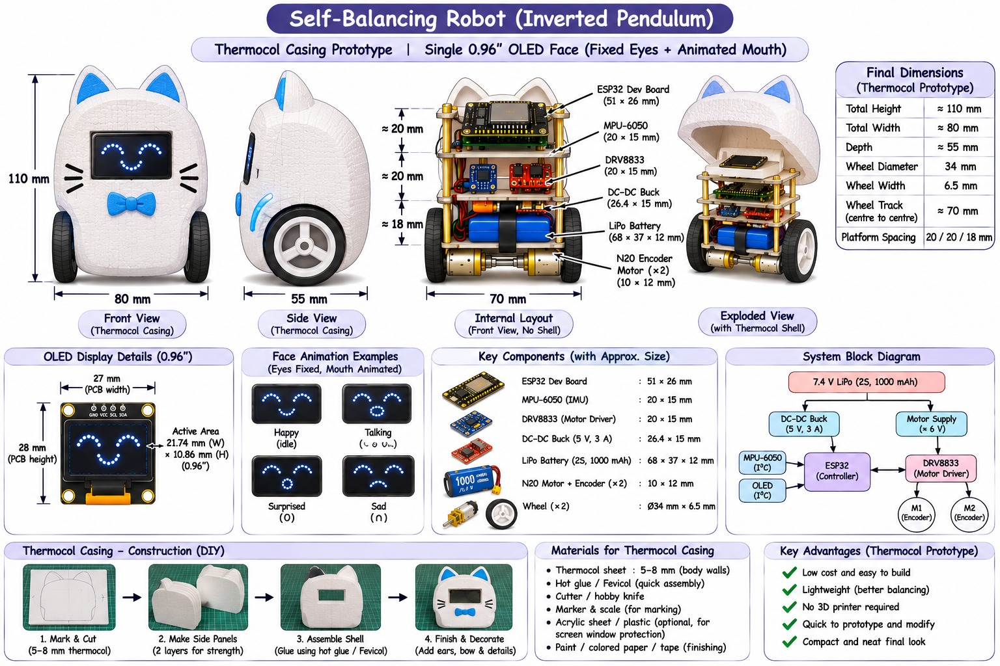

# BO-BOT: Self-Balancing Cat Robot

An ESP32-based self-balancing (inverted pendulum) robot with a cat-shaped thermocol casing and an animated OLED face.
This repository holds **everything** for the project: CAD, firmware, simulation, electronics, wiring, hardware
build notes, components, and photos/videos. It is updated as the project grows.

## Key specs
| Item | Value |
|---|---|
| Body (H x W x D) | ~110 x 80 x 55 mm |
| Wheels | 34 mm dia x 6.5 mm, 70 mm track |
| Platform spacing | 20 / 20 / 18 mm |
| Controller | ESP32 dev board |
| IMU | MPU-6050 (I2C) |
| Motor driver | DRV8833 |
| Motors | 2x N20 with encoder |
| Power | 2S 1000 mAh LiPo (7.4 V) + 5 V DC-DC buck |
| Display | 0.96" OLED (I2C), fixed eyes + animated mouth |
| Casing | Thermocol (5-8 mm) prototype |

## Repository layout
| Folder | What goes here |
|---|---|
| [`cad/`](cad/) | Fusion 360 scripts (Python + C++), exported `.f3d` / `.step` / `.stl` files |
| [`firmware/`](firmware/) | ESP32 code (balancing controller, motor/encoder, OLED face) |
| [`simulation/`](simulation/) | Python / MATLAB / web simulations and tuning results |
| [`simulink/`](simulink/) | Simulink models (`.slx`) and related scripts |
| [`hardware/`](hardware/) | Mechanical build notes: thermocol casing, assembly steps, drawings |
| [`electronics/`](electronics/) | Schematics, power design, PCB / breadboard layouts |
| [`wiring/`](wiring/) | Wiring diagrams and pin maps |
| [`components/`](components/) | Bill of materials, datasheets, suppliers |
| [`media/`](media/) | Photos and videos of the build and demos |
| [`docs/`](docs/) | Reports, project log, reference images |

## Status
See [`docs/project-log.md`](docs/project-log.md) for progress and the to-do list.

## Contributing / workflow
- Keep one topic per commit with a clear message.
- Put large binaries (videos, CAD exports) in their folders; avoid committing files over ~50 MB.
- Update the folder README when you add something new.
