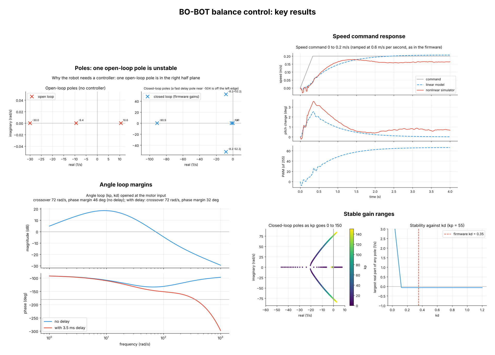
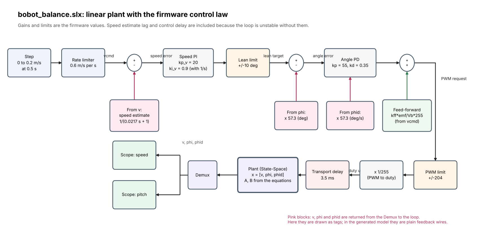
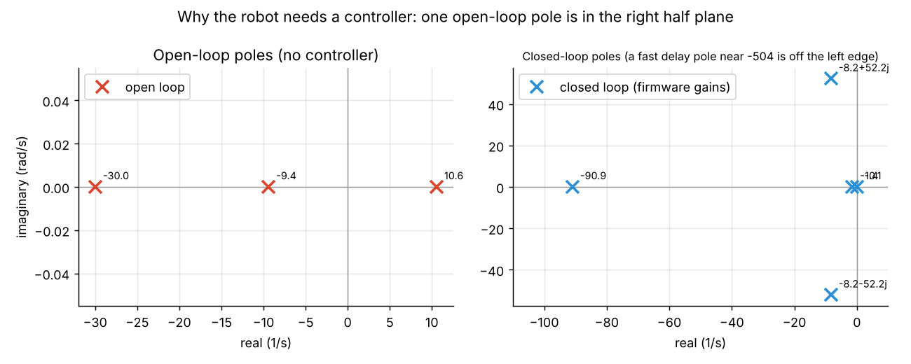
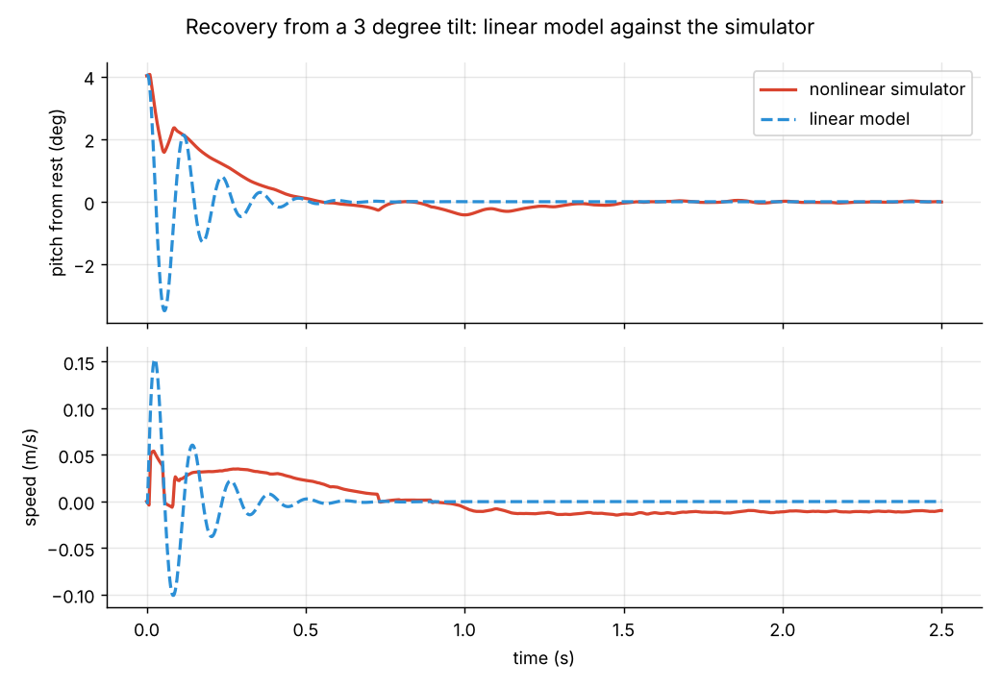
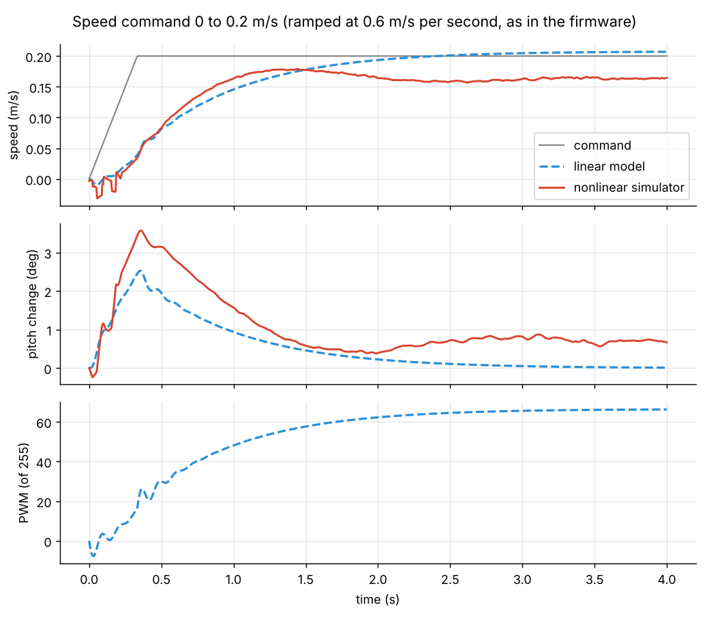
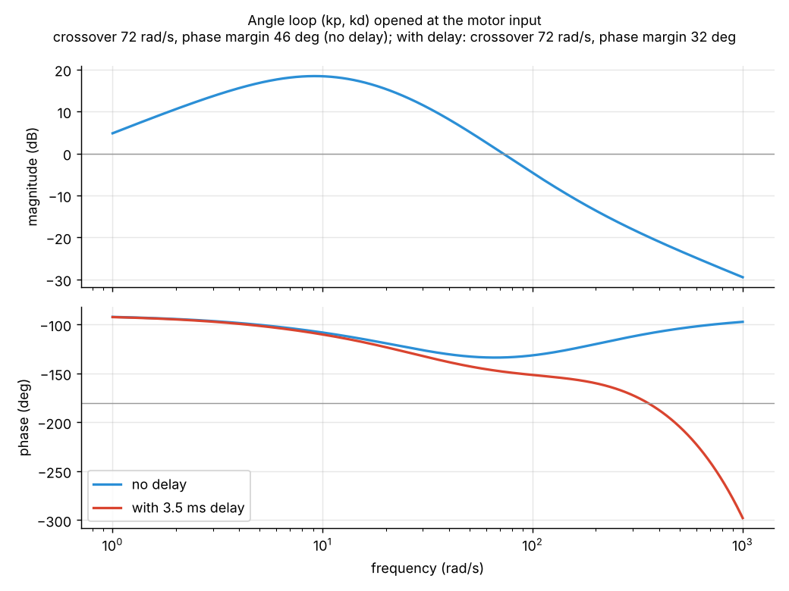
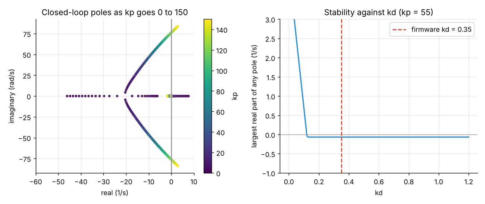
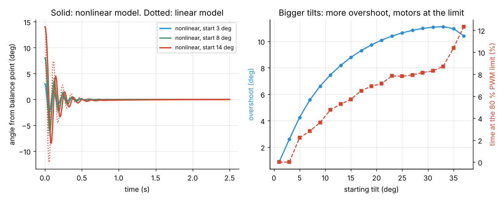
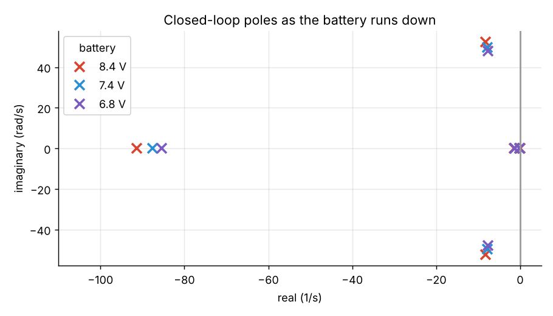

# Simulink and MATLAB

The maths behind the balance controller, with graphs. The full derivation is in [`docs/equations.md`](../docs/equations.md).

| File | What it is |
|---|---|
| `bobot_params.m` | All physical and controller parameters (same values as the simulator and the firmware) |
| `bobot_analysis.m` | Linear model, closed loop with the firmware gains, poles, Bode margins, gain sweeps, step and tilt responses, nonlinear check |
| `bobot_closed.m`, `bobot_nonlinear.m` | Helper functions for the analysis script |
| `build_bobot_model.m` | Builds the Simulink model `bobot_balance.slx` from code, runs it, saves a picture of the model and the result graphs |
| `model-diagram.png`, `draw_model_diagram.py` | Block diagram picture of the model, and the script that draws it |
| `python/bobot_linear_model.py` | The same calculation in Python; produced the graphs in `results/` (`python/make_overview.py` builds the overview page) |
| `data/` | Traces recorded from the nonlinear web simulator, used to check the linear model |
| `results/` | Graphs (PNG) and `summary.json` with the numbers |

## Overview

## Simulink model

*This picture shows the model that `build_bobot_model.m` builds: the linear plant, the speed loop and angle loop with the firmware gains, the PWM limit and the control delay. After you run the script in MATLAB it also saves a real screenshot of the model in `results_matlab/`.*

## All graphs

| | |
|---|---|
|  |  |
| Open-loop poles: one is unstable | Linear model against the simulator, 3° tilt |
|  |  |
| Speed command response | Angle loop margins |
|  |  |
| Gain sweeps | Larger tilts, nonlinear model |
|  | |
| Battery voltage | |

## Run it

**MATLAB** (R2018b or newer, Control System Toolbox):
1. Open the `simulink` folder in MATLAB.
2. Run `bobot_analysis`. It prints a **SELF-CHECK** that compares its numbers with the Python results (poles, margins, stable gain range) and saves figures in `results_matlab/`. You want to see `SELF-CHECK PASSED`.
3. Run `build_bobot_model`. It builds `bobot_balance.slx`, runs it, prints a **SIMULINK CHECK**, and saves a screenshot of the model and the result graph in `results_matlab/`.
4. Open `bobot_balance.slx` and double-click the two scopes to see speed and pitch. Change gains in `bobot_params.m` and run again.

**Python** (numpy, scipy, matplotlib): `python simulink/python/bobot_linear_model.py`, then `python simulink/python/make_overview.py`.

## Status
- **Checked:** the Python calculation and all the graphs. The linear model agrees with the nonlinear simulator for the speed response and for the time scale of tilt recovery (see section 7 of [`docs/equations.md`](../docs/equations.md) for the differences).
- **Not checked:** the MATLAB scripts and the Simulink builder have **not been run in MATLAB** yet. They are written to give the same numbers as the Python version, and the self-checks above will tell you if they do. If a check says FAIL or MATLAB shows an error, send me the output and I will fix it.
- **After your first successful run:** commit the generated `bobot_balance.slx` and the pictures from `results_matlab/` (these replace the drawn diagram with a real screenshot), and write your MATLAB version here.
