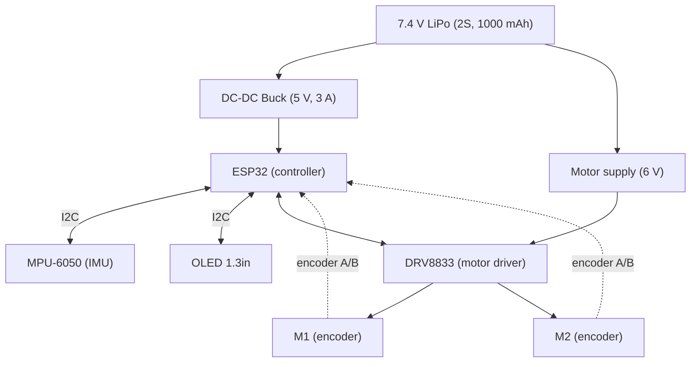

# Wiring

## System block diagram (from the reference sheet)

## Pin map
Fill this in once the firmware pins are final. Do not guess; copy from the firmware config.

| Signal | ESP32 pin | Connects to |
|---|---|---|
| I2C SDA | | MPU-6050, OLED |
| I2C SCL | | MPU-6050, OLED |
| Motor A IN1 / IN2 | | DRV8833 |
| Motor B IN1 / IN2 | | DRV8833 |
| Encoder A (A / B) | | M1 encoder |
| Encoder B (A / B) | | M2 encoder |
| Battery voltage sense | | divider (optional) |

## Notes
- Add photos or Fritzing / KiCad exports of the wiring here.
- Check polarity on the XT30 battery connector before powering on.
