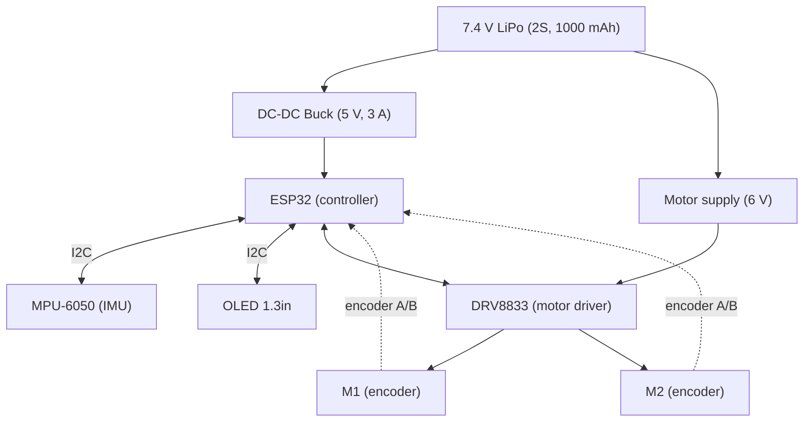

# Wiring

## System block diagram (from the reference sheet)

## Pin map (ESP32 DevKit)
These pins match [`firmware/balance_bot/include/config.h`](../firmware/balance_bot/include/config.h). If you change a pin,
change it in both places.

| Signal | ESP32 pin | Connects to |
|---|---|---|
| I2C SDA | GPIO 21 | MPU-6050 SDA and OLED SDA |
| I2C SCL | GPIO 22 | MPU-6050 SCL and OLED SCL |
| Left motor IN1 / IN2 | GPIO 25 / 26 | DRV8833 AIN1 / AIN2 |
| Right motor IN1 / IN2 | GPIO 27 / 4 | DRV8833 BIN1 / BIN2 |
| Left encoder A / B | GPIO 32 / 33 | Left motor encoder outputs |
| Right encoder A / B | GPIO 34 / 35 | Right motor encoder outputs |
| Battery voltage sense | GPIO 36 | Midpoint of a 10 k / 4.7 k divider across the battery |

Power connections:

| From | To |
|---|---|
| Battery + (through the XT30 / switch) | DRV8833 VM, buck converter input, top of the battery divider |
| Buck converter 5 V output | ESP32 VIN (5 V pin) |
| ESP32 3V3 | MPU-6050 VCC, OLED VCC, both encoder supply pins |
| All grounds | One common ground (battery, buck, ESP32, DRV8833, sensors, encoders) |
| Divider bottom resistor | GND |

## Notes
- **Power the encoders from 3V3, not 5 V.** Their outputs follow the supply voltage, and the ESP32 inputs must not see
  more than 3.3 V.
- **Battery divider:** 10 k from battery + to GPIO 36, 4.7 k from GPIO 36 to GND. A full 8.4 V pack gives about 2.7 V at the pin.
- **DRV8833 sleep pin:** if your module has an `SLP` / `nSLEEP` pin, connect it to 3V3 or the motors stay off.
- **Do not power the robot from the battery and from USB at the same time** unless the board has a protection diode.
  Use USB alone for programming on the bench, with the motor battery disconnected.
- Check polarity on the XT30 battery connector before powering on.
- Add photos or Fritzing / KiCad exports of the wiring here.
